# GitHub Policy-Governed Jira Delivery

This document defines the target Jira-to-GitHub Fullsend workflow following [UIE Delivery Standards](https://redhat.atlassian.net/wiki/x/aM4hGQ). It is a planning document, not a description of current behavior.

[[_TOC_]]

## Iterative Plan to update this document

1. ✅ Establish baseline and terminology.
   - Verify upstream Fullsend capabilities and extension points.
   - Define authoritative terms: Jira issue/work item, GitHub pull request, Fullsend agent run/harness, labels, and actors.
   - Separate confirmed upstream behavior, proposed repository extensions, and open assumptions.
2. ✅ Define governance and intake.
   - Specify eligible Jira issue types, required UIE fields, repository-routing format, human authorization, and validation ownership.
   - Define policy-validation failures and the human re-authorization path.
3. ✅ Define triage and the human hand-off to code.
   - Detail triggers, claim and idempotency behavior, triage outputs, Jira evidence, amendment proposals, and the explicit human decision to authorize coding.
4. ✅ Define code delivery and the hand-off to review.
   - Detail the code-stage trigger, non-draft pull-request creation, status reporting, code outcomes, Jira/GitHub links, and manual review promotion.
   - Defer branch naming, target-branch selection, pull-request body/metadata, and CI expectations to upstream code-harness behavior and target-repository conventions.
5. ✅ Define review, fix, and merge governance.
   - Define review sources and normalized outcomes, automated-fix eligibility, upstream automatic/manual fix budgets, escalation, required human review, and merge authority.
6. ✅ Map the design to Fullsend and this test repository.
   - Maintain the Upstream Fullsend Differences, Upstream Issue Tracking, and Candidate Issues to Propose Upstream sections as upstream facts are verified.
   - Add a repository implementation-change inventory grouped by configuration, workflows, labels, GitHub protections, Jira configuration, credentials, and validation tests.
7. ✅ Reconcile and validate the complete design.
   - Reconcile the target-behavior diagram, state tables, acceptance criteria, failure modes, and terminology.
   - Explicitly list unresolved decisions and prerequisites.

The Target Workflow diagram describes the intended UIE Delivery Standard behavior only. Upstream support and repository-specific extensions are documented separately in Upstream Fullsend Differences.

## Terminology and Baseline

The target workflow uses the following terms:

| Term | Meaning |
|---|---|
| Jira issue | The user-facing Jira record. Fullsend represents this entity as a `work_item` in normalized events; use that term only when describing Fullsend configuration or event mechanics. |
| GitHub pull request (PR) | The GitHub change proposal created or updated by the code and fix stages. |
| Fullsend harness | The declarative YAML configuration for an agent's behavior, triggers, scripts, environment, and runtime context. |
| Fullsend agent | A named capability or stage, such as triage, code, review, or fix. |
| Fullsend agent run | One execution of a harness for a dispatched event and entity. |
| GitHub Actions workflow | The GitHub Actions automation definition that polls Jira or hosts Fullsend agent execution. |
| GitHub Actions workflow run | One execution of a GitHub Actions workflow; use this term for execution evidence and links. |
| Jira poller's bot identity | The dedicated non-human Jira identity authenticated by the poller. The current Fullsend contract uses an email-bound Jira API token and HTTP Basic authentication; it is not an Atlassian-managed service account. |
| Dispatch | A poller-created record routing an event to a Fullsend agent run. A dispatch is not evidence that the agent run completed. |
| UIE Delivery Gate | The repository-owned policy evaluation that decides whether a Jira issue may enter a stage. It is not currently an upstream Fullsend primitive. |
| Stage trigger label | A human-applied Jira label requesting a stage, such as `ready-for-triage` or `ready-to-code`. |
| Stage claim label | A Fullsend-applied Jira label recording an active stage, such as `triage-in-progress` or `code-in-progress`. |
| Execution evidence | Jira comments and remote links, GitHub pull-request links, Fullsend agent-run records, and GitHub Actions workflow-run URLs. Labels signal current state but are not sufficient historical evidence. |

The canonical routing label is `repo:github/<owner>/<repository>`, which identifies the GitHub forge explicitly and prevents name collisions with GitLab repositories. This is a UIE repository-routing convention, not an upstream Fullsend-required label format.

The target workflow allows either a stage trigger label or its corresponding argumentless Jira slash command (`/fs-triage` or `/fs-code`) to request triage or code. Both trigger types must pass the same UIE Delivery Gate. A target slash command must be the complete first line of the Jira comment; it does not accept an instruction argument.

The target workflow diagram describes the intended UIE Delivery Standard behavior only. Upstream support and repository-specific extensions are documented separately in Upstream Fullsend Differences.

## Scope

The preferred implementation path accepts one Jira issue for one GitHub repository only. Fullsend starts implementation only when an actor other than the configured Jira poller's bot identity applies an appropriate label or posts an appropriate slash command on a Jira issue that matches UIE Delivery Standards, e.g. per [issue type Exit/Entry criteria](https://redhat.atlassian.net/wiki/spaces/UIE/pages/421926030/Entry+Exit+Criteria).

Only Story, Task, and Bug are eligible for Fullsend work, including triage and code execution. Spike, Epic, Initiative, Feature, and Outcome work items do not enter a Fullsend path...yet.

## Target Workflow

Action nodes use the convention **Actor in Space: action**. Jira and GitHub state nodes and decision nodes omit the actor prefix.

```mermaid
flowchart TD
    human["Human in Jira: creates and refines work"]
    jiraBacklog["Jira: New, Refinement, or Backlog\nDiscovery and readiness work"]
    uiCriteria["Human in Jira: satisfies UIE\nBacklog exit criteria"]
    moveInProgress["Human in Jira: transitions issue\nfrom Backlog to In Progress"]
    triageTrigger["Human in Jira: verifies exactly one repo: label\nand adds ready-for-triage or /fs-triage"]

    triageRunStatus["Fullsend in Jira: posts triage\nrun-status comment"]
    triage["Fullsend in GitHub: executes\ntriage quality review"]
    triageAction{"Triage action?"}
    triageDisposition["Fullsend in Jira: records\nupstream triage disposition"]
    triageFollowUp["Human in Jira: follows the\ntriage disposition"]

    triagePoll["Fullsend in GitHub: polls Jira\nfor a triage trigger"]
    triageGate{"UIE Delivery Gate passes?"}
    triageRejected["Fullsend in Jira: posts policy-rejection comment\nand removes ready-for-triage"]
    triageWorkflow["Fullsend in GitHub: starts triage workflow"]
    triageClaim["Fullsend in Jira: replaces ready-for-triage\nwith triage-in-progress"]
    triageResult["Fullsend in Jira: posts triage action\nand next-steps comment; removes triage-in-progress"]

    codeTrigger["Human in Jira: adds ready-to-code\nor /fs-code"]
    codePoll["Fullsend in GitHub: polls Jira\nfor a code trigger"]
    codeGate{"UIE Delivery Gate still passes?"}
    codeRejected["Fullsend in Jira: posts policy-rejection comment\nand removes ready-to-code"]

    codeWorkflow["Fullsend in GitHub: starts code workflow"]
    codeClaim["Fullsend in Jira: replaces ready-to-code\nwith code-in-progress"]
    codeRunStatus["Fullsend in Jira: posts code\nrun-status comment"]
    code["Fullsend in GitHub: executes\ncode agent harness"]
    codeOutcome{"Code outcome?"}
    pr["Fullsend in GitHub: creates\nnon-draft pull request"]
    codeCompletion["Fullsend in Jira: posts code-completion comment\nwith workflow-run and PR links; removes code-in-progress"]
    codeNoPr["Fullsend in Jira: posts terminal no-PR or skipped outcome\nand removes code-in-progress"]
    codeFailure["Fullsend in Jira: posts terminal failure evidence\nand removes code-in-progress"]
    codeFollowUp["Human in Jira: refines, reroutes, or explicitly\nre-triggers code after remediation"]
    reviewTrigger["Human in GitHub: applies ready-for-review\nor posts /fs-review"]
    review["Fullsend in GitHub: executes\nreview agent harness"]
    reviewSummary["Fullsend in GitHub: posts review summary\nand inline PR comments"]
    jiraReview["Fullsend in Jira: posts review-completed comment\nwith workflow-run link"]
    reviewOutcome{"Review outcome?"}
    readyForMerge["Fullsend in GitHub: applies\nready-for-merge"]
    manualReview["Fullsend in GitHub: applies\nrequires-manual-review"]
    rejected["Fullsend in GitHub: applies rejected"]
    autoFix{"Automatic fix permitted?"}
    fix["Fullsend in GitHub: executes\nfix agent harness"]
    fixResult["Fullsend in GitHub: pushes\nincremental fix"]
    fixJira["Fullsend in Jira: posts fix-completed comment\nwith PR and workflow-run links"]
    fixCap["Fullsend in GitHub: stops automatic fix dispatch\nneeds-human marks approach to the cap"]
    humanMerge["Human in GitHub: reviews and merges PR"]
    humanReview["Human in GitHub: resolves review outcome\nor remaining requested changes"]

    human --> jiraBacklog
    jiraBacklog --> uiCriteria
    uiCriteria --> moveInProgress
    moveInProgress --> triageTrigger
    triageTrigger --> triagePoll
    triagePoll --> triageGate
    triageGate -->|"No"| triageRejected
    triageRejected --> uiCriteria
    triageGate -->|"Yes"| triageWorkflow
    triageWorkflow --> triageClaim
    triageClaim --> triageRunStatus
    triageRunStatus --> triage
    triage --> triageResult
    triageResult --> triageAction
    triageAction -->|"sufficient"| codeTrigger
    triageAction -->|"any other action"| triageDisposition
    triageDisposition --> triageFollowUp
    codeTrigger --> codePoll
    codePoll --> codeGate
    codeGate -->|"No"| codeRejected
    codeRejected --> uiCriteria
    codeGate -->|"Yes"| codeWorkflow
    codeWorkflow --> codeClaim
    codeClaim --> codeRunStatus
    codeRunStatus --> code
    code --> codeOutcome
    codeOutcome -->|"Pull request created"| pr
    pr --> codeCompletion
    codeCompletion --> reviewTrigger
    codeOutcome -->|"Skipped or no pull request"| codeNoPr
    codeOutcome -->|"Failed run"| codeFailure
    codeNoPr --> codeFollowUp
    codeFailure --> codeFollowUp
    reviewTrigger --> review
    review --> reviewSummary
    reviewSummary --> jiraReview
    jiraReview --> reviewOutcome
    reviewOutcome -->|"approve"| readyForMerge
    readyForMerge --> humanMerge
    reviewOutcome -->|"request-changes"| autoFix
    reviewOutcome -->|"comment or failure"| manualReview
    manualReview --> humanReview
    reviewOutcome -->|"reject"| rejected
    rejected --> humanReview
    autoFix -->|"No"| humanReview
    autoFix -->|"Yes"| fix
    fix -->|"Automatic budget remains"| fixResult
    fix -->|"Automatic budget exhausted"| fixCap
    fixCap --> humanReview
    fixResult --> fixJira
    fixJira --> reviewTrigger
```



## Policy-Governed Entry Contract

The UIE Delivery Gate runs after a Jira event has routed to this repository but before Fullsend claims a stage or invokes its harness. It evaluates a current Jira read rather than relying only on the invoking event payload. It runs before triage and again before code execution.

The gate returns every failed criterion in one result. A rejection does not create a stage claim or invoke an agent. Fullsend posts one idempotent policy-rejection comment. For a label trigger, it removes only the applicable trigger label; for a slash-command trigger, it leaves the command comment unchanged. A new qualifying trigger event is required after remediation; the poller must not dispatch work merely because an issue remains in a qualifying state.

| Requirement | Required value |
|---|---|
| Work type | Story, Task, or Bug |
| Jira lifecycle status | In Progress |
| Current Sprint | Contains at least one Jira Sprint whose state is `active`; a future-only or closed-only Sprint value is not eligible |
| Assignee | Set to an assigned user |
| Summary | Not empty |
| Description | Not empty |
| Priority | Set |
| Acceptance Criteria | Not empty |
| Story Points | Positive numeric value |
| Repository ownership | Exactly one `repo:github/<owner>/<repository>` label |
| Stage trigger | A new `ready-for-triage` or `ready-to-code` label-addition event, or an exact first-line `/fs-triage` or `/fs-code` comment, for the requested stage |
| Trigger actor | Any actor identity other than the configured Jira poller's bot identity |

The UIE Delivery Gate rejects Spike, Epic, Initiative, Feature, and Outcome work from Fullsend triage and implementation. These items require decomposition into eligible work items.

### Stage-Specific Intake

Triage requires only the common gate requirements. Code requires the common requirements and a latest `sufficient` triage action. Every other upstream triage action cannot authorize code execution.

The UIE target behavior requires a new trigger from an actor other than the Jira poller's bot identity after a `sufficient` triage action. This is a UIE policy, not an upstream Fullsend limitation. A future Delivery Standard may instead enable and authorize an upstream-compatible autonomous triage-to-code handoff.

Jira project membership and permission enforcement remain Jira responsibilities. This workflow does not add an authorization or assignee-membership check beyond excluding the configured Jira poller's bot identity as a stage-trigger actor.

### Trigger Loop Prevention and Autonomous Handoff Compatibility

Jira events authored by the configured Jira poller's bot identity must not qualify as UIE stage-trigger events or re-trigger the Jira poller. This loop-prevention rule does not prohibit a separately configured Fullsend autonomous handoff from triage to code.

### Policy Implementation Implications

- The current `.fullsend/harness/triage.yaml` explicitly disables upstream autonomous code handoff in both runner and sandbox environments with `TRIAGE_AUTO_CODE: "off"` and `TRIAGE_AUTO_CODE_CATEGORIES: ""`. Retain those settings for the UIE default.
- Configure the poller and every Jira mutation used by the workflow to authenticate as the same Jira poller's bot identity. This lets upstream self-authored-event filtering and the UIE trigger-actor check prevent poll loops.
- Implement the Delivery Gate and Jira trigger handling so a label-addition or slash-command event from the Jira poller's bot identity cannot authorize a UIE stage.
- Configure or extend stage concurrency so a later trigger cannot cancel an active UIE triage or code run. When a stage claim exists, the Delivery Gate must preserve the active run and emit idempotent active-run feedback instead.
- Require the Jira Sprint custom field to contain an object whose `state` is `active`. Do not treat a non-empty Sprint value as sufficient because Jira retains closed sprints and can assign future sprints.
- Use Jira comment properties as markers for idempotent, visible Jira run-status and applicable triage-result comments.
- A future autonomous triage-to-code handoff requires an explicit UIE Delivery Standard revision and a corresponding change to the triage harness configuration; it must not simulate a human Jira trigger.

### Governance Signals

After the UIE Delivery Gate accepts an issue and GitHub has started its stage workflow, Fullsend records the approved execution through:

- Replacing `ready-for-triage` with `triage-in-progress` for the triage stage, then removing `triage-in-progress` when triage completes.
- Replacing `ready-to-code` with `code-in-progress` for the code stage.
- Jira run-status comments that record the triage and code workflow executions.
- Subsequent Jira comments, remote links, labels, and transitions as the implementation, review, and fix stages progress.

These signals are execution evidence and audit records. They do not replace the UIE Delivery Gate's validation or claims of the Jira issue.

### Stage-Label State Transitions

| Event | Jira label action | Jira feedback | Next action |
|---|---|---|---|
| Triage gate rejects | Remove `ready-for-triage` for a label trigger; no label change for a command trigger | Policy-rejection comment with all failed criteria | Human remediates and reapplies `ready-for-triage` or posts `/fs-triage` |
| Triage trigger while `triage-in-progress` exists | Retain `triage-in-progress`; remove the duplicate `ready-for-triage` label when present | Idempotent active-run comment with the existing workflow-run link | Preserve the active run; human waits for its terminal result |
| Triage workflow starts | Replace `ready-for-triage` with `triage-in-progress` | Triage run-status comment | Triage harness executes |
| Triage completes with `sufficient` | Remove `triage-in-progress` | Triage-result comment instructing the human to trigger code | Human applies `ready-to-code` or posts `/fs-code` |
| Triage completes with any other upstream action | Remove `triage-in-progress` | Triage-result comment records the upstream action and its disposition | Human follows the triage disposition; code cannot start from this result |
| Code gate rejects | Remove `ready-to-code` for a label trigger; no label change for a command trigger | Policy-rejection comment with all failed criteria | Human remediates and reapplies `ready-to-code` or posts `/fs-code` |
| Code trigger while `code-in-progress` exists | Retain `code-in-progress`; remove the duplicate `ready-to-code` label when present | Idempotent active-run comment with the existing workflow-run link | Preserve the active run; human waits for its terminal result |
| Code workflow starts | Replace `ready-to-code` with `code-in-progress` | Code run-status comment | Code harness executes |
| Code creates pull request | Remove `code-in-progress` | Code-completion comment with pull-request and workflow-run links; requests human review promotion | Human applies `ready-for-review` or posts `/fs-review` |
| Triage or code failure, cancellation, missing result, no diff, or repository mismatch | Remove the active stage label | Failure or outcome comment with workflow-run link | Human explicitly reapplies the appropriate trigger after remediation |

The state machine is idempotent. A retry must not create duplicate workflow runs, comments, or conflicting labels, and Fullsend never restores a trigger label automatically.

Upstream Fullsend's default GitHub triage path does not implement this `ready-for-triage` to `triage-in-progress` lifecycle and can cancel an active stage run when a newer trigger arrives. UIE deliberately differs: one active stage run is preserved, and duplicate stage triggers are rejected without cancelling it.

### Triage-Result Comment Contract

The triage-result comment is the human-readable decision record and must include:

- The schema-valid upstream triage action listed in [Upstream Triage Agent Outcomes](upstream-triage-agent-outcomes.md).
- A concise summary of findings, including ambiguities, edge cases, repository constraints, test expectations, and scope concerns.
- Any structured amendment proposal: affected Jira field, proposed change, and rationale.
- The required human next action for the upstream action.
  - For `sufficient`, apply `ready-to-code` or post `/fs-code` when an actor other than the Jira poller's bot identity approves the code request.
  - For every other action, follow its upstream disposition; it does not authorize code execution.
- A link to the triage workflow run or its run-status record.

The triage run-status comment and triage-result comment are separate records. The run-status comment reports execution state; the result comment records assessment and next steps. The result-comment behavior follows the upstream action model: `sufficient` and `in-progress` update their own sticky records, while other actions create their normal result comments. For Jira, Fullsend implements sticky-comment semantics with Jira comment entity properties; the marker is not embedded in the visible comment body.

## Code Delivery and Review Handoff

Code runs against the Jira issue and the target repository after a `sufficient` triage action and a new authorized code trigger. A successful code run creates a non-draft GitHub pull request.

### Manual Review Promotion

Manual promotion is the UIE default and follows the same human-in-the-loop pattern as triage and code authorization. After code creates the pull request, Fullsend does not apply `ready-for-review`. A human starts Fullsend review by applying `ready-for-review` or posting `/fs-review` on the pull request.

Automatic code-to-review promotion remains an allowed upstream-compatible option, but is not the UIE default. It must be explicitly enabled; it is not recovered by state-based dispatch after a manual-promotion code run.

### Code Outcomes

The UIE outcome mapping follows [Upstream Code Agent Outcomes](upstream-code-agent-outcomes.md):

| Upstream outcome | UIE Jira evidence and label action | Next action |
|---|---|---|
| Skipped | Remove `code-in-progress`; post terminal run-status evidence and the skip reason. | Human resolves the reported condition and issues a new code trigger if work should continue. |
| Pull request created | Remove `code-in-progress`; post a code-completion comment with the pull-request and workflow-run links. | Human promotes the pull request to review with `ready-for-review` or `/fs-review`. |
| No pull request | Remove `code-in-progress`; post an idempotent outcome comment describing whether no change was needed or work belongs upstream. | Human closes, reroutes, refines, or issues a new code trigger as appropriate; no review starts. |
| Failed run | Remove `code-in-progress`; post terminal run-status evidence with the failure detail and workflow-run link. | Human remediates and issues a new code trigger if another attempt is required. |

For Jira-sourced runs, upstream routes lifecycle status notifications to Jira but does not automatically post the built-in code post-script's source-item comments or labels there. UIE requires custom Jira outcome comments for the code outcomes above.

### Code-Delivery Implementation Implications

The upstream code post-script unconditionally applies `ready-for-review`. Until [agents#1769](https://github.com/fullsend-ai/agents/issues/1769) provides a supported automatic/manual promotion setting, the UIE default requires a base-composed code harness with a replacement post-script that omits that label operation while retaining normal pull-request creation and completion behavior. Review routing must be configured at the `review` agent entry in `.fullsend/config.yaml` to accept only human `ready-for-review` label additions and human `/fs-review` comments; modifying a review harness trigger alone does not change built-in review routing.

## Review and Fix Loop

Code runs are Jira-sourced, so upstream lifecycle status notifications route to the Jira issue. Review and fix runs are triggered from the GitHub pull request, so their upstream lifecycle status notifications route to that pull request rather than Jira. The target Jira review-completed, fix-completed, and escalation comments therefore require custom, idempotent Jira feedback with pull-request and workflow-run evidence.

After the review-completed Jira comment, Fullsend applies GitHub pull-request labels for the applicable normalized review outcomes. A new review clears stale `ready-for-merge` before applying its current outcome labels.

| Review outcome | GitHub label | Next action |
|---|---|---|
| `approve` | `ready-for-merge` when the non-draft pull request passes upstream safety gates | Human review and merge; Fullsend does not merge. |
| `request-changes` | No outcome label | Evaluate automatic fix. |
| `comment` | `requires-manual-review` | Human reviews and resolves the advisory findings. |
| `reject` | `rejected` | Fullsend closes the pull request; human reworks or reopens it if appropriate. |
| `failure` | No outcome label | Human investigates the failed review; a failure before valid output may have no substantive review comment. |

An `approve` outcome may be downgraded to `comment` when protected paths or a high, missing, or degraded risk assessment applies. Only a `request-changes` review outcome enters the automated-fix branch. On a same-repository pull request, the GitHub review event triggers automatic fix unless `fullsend-no-fix` suppresses bot-triggered runs; fork pull requests are blocked from automatic fix.

Upstream permits up to five automatic fix runs per pull request. A `fullsend-fix-budget/N` label can lower that automatic budget, and `needs-human` marks a pull request approaching the cap. Manual `/fs-fix [instructions]` runs are separately available to a user with write-level repository permission and allow up to ten total fix runs per pull request, shared with automatic runs. `/fs-fix-stop` applies `fullsend-no-fix` to stop automatic fixes; it does not prevent manual `/fs-fix`.

Each successful fix pushes an incremental commit, posts a pull-request summary, and posts custom Jira fix-completed feedback with pull-request and workflow-run links. Because UIE uses manual review promotion, a human must apply `ready-for-review` or post `/fs-review` to request another review after the fix. When the automatic budget is exhausted, Fullsend stops automatic fix dispatch and the remaining changes require human resolution or an eligible manual `/fs-fix` request.

## Triage Quality Review and Field Amendments

Triage follows a human's initial refinement of all required fields. It uses the Jira issue as its tracker entity and the entire target repository as implementation context; it does not create or require a GitHub issue. For an eligible Story, Task, or Bug, it identifies ambiguous acceptance criteria, edge cases, missing error handling, repository constraints, test expectations, or scope that is too broad for one implementation. An `in-progress` action may identify and consider an existing open pull request, including a draft pull request; triage does not create a draft pull request.

Triage does not directly overwrite human-authored UIE fields. It produces a structured amendment proposal in Jira that identifies the field, the proposed change, and the supporting rationale. A human reviews and applies the amendment, then reapplies `ready-for-triage` or posts `/fs-triage` so a new `sufficient` triage result can permit a subsequent code trigger.

A future authorized field-update capability must:

- Limit updates to an allowlist of explicitly supported Jira fields.
- Resolve project-specific custom-field IDs, including Acceptance Criteria and Current Sprint.
- Use an explicit human authorization signal for each accepted amendment.
- Detect or reject concurrent human edits rather than overwriting them.
- Post an audit comment with the accepted field changes.

### One Jira Issue to Multiple Repositories

This design requires one Jira issue to resolve to one GitHub repository. A future design may support one Jira issue producing multiple repository-specific pull requests. It requires a separate workflow diagram and decisions about routing cardinality, ownership, independent claims, partial completion, review, and Jira status reconciliation.

## Deferred or Out of Scope

- Invalidating a `sufficient` triage result when selected Jira fields change after triage.
- Validating that the Jira assignee is an active Jira-project member or belongs to a delivery team.
- Replacing the UIE default human triage-to-code handoff with an explicitly configured and authorized Fullsend autonomous handoff.
- Integrating Fullsend installation and UIE-specific workflows or configuration with a target repository's existing GitHub Actions workflows, CI policy, branch protections, and operator-specific review timing.
- Defining target-repository branch naming, target-branch selection, pull-request body or metadata, and CI expectations beyond upstream code-harness behavior.

## Upstream Fullsend Differences

| Capability | Upstream Fullsend | Component today | Required direction |
|---|---|---|---|
| Jira polling | Pre-alpha Jira poller converts Jira comments and label changes into normalized events and dispatch records, with checkpoint and entity-property coordination. | A scheduled repository workflow polls Jira every five minutes when enabled. | Retain upstream polling; document and validate its delivery, lock, and retry limits for UIE use. |
| Built-in Jira triggers | Built-in harnesses do not yet provide native Jira CEL triggers. | Repository triage and code harness overlays define Jira-specific CEL triggers. | Keep repository triggers until upstream ships native Jira triggers. |
| Jira agent execution | Jira-sourced built-in-agent runs currently expect GitHub issue context; substantive built-in-agent results are written to GitHub by default. | The repository dispatches triage and code from Jira events, but target Jira-stage result behavior requires extensions. | Add custom Jira-aware stage behavior or wait for upstream built-in Jira work-item support. |
| Jira comments | Built-in agent processing does not use Jira for substantive results. | The repository gate posts visible, idempotent rejection, active-run, and start comments through the Jira REST API; the local Jira dispatcher posts triage and code terminal comments. Review, fix, and escalation comments remain unimplemented. | Add PR-stage lifecycle hooks that publish the remaining Jira evidence with workflow-run and pull-request links. |
| Jira labels and transitions | The default GitHub triage path retains `ready-for-triage` and has no temporary `triage-in-progress` lifecycle. Jira labels are available as poller inputs. | The repository gate creates claims with Jira entity properties and applies/removes trigger and active-stage labels before dispatch. The local dispatcher removes triage/code claims at terminal completion. | Add PR-stage claim and feedback lifecycle handling, plus any required Jira transitions. |
| Repository routing | Per-repository JQL and CEL triggers can segment Jira issues; upstream does not require a repository-routing label format. | Current route label is `repo:github/jasonawant/uie-fullsend-adoption-example` in the Jira poller and Jira triage/code harness overlays. | Retain the forge-qualified `repo:github/<owner>/<repository>` UIE convention and require exactly one route label. |
| Dispatch claims | The poller uses Jira entity properties for coordination; upstream stage concurrency can cancel an active run for a newer trigger. | The repository-owned Jira dispatcher uses non-cancelling per-stage concurrency and an always-run completion step. | Retain the local dispatcher until upstream provides equivalent claim and completion controls. |
| Code-to-review promotion | The code post-script unconditionally adds `ready-for-review`; default review routing also accepts automatic pull-request events. | The local dispatcher records a Jira correlation marker and removes the automatic label. The local PR router rejects bot label events and accepts only human `ready-for-review` or exact `/fs-review`. | Use the upstream automatic/manual promotion capability when available and retire the local routing workaround. |
| Review feedback | Review findings, verdicts, labels, and lifecycle status notifications are pull-request-scoped. | The local PR dispatcher resolves the bot-authored Jira correlation marker and posts idempotent review lifecycle feedback to Jira. | Add normalized review-outcome extraction to enrich the Jira feedback beyond lifecycle status. |
| Fix budget and feedback | Upstream permits five automatic fix runs per pull request and ten total manual fix runs shared with automatic runs; fix status and summaries are pull-request-scoped. | The local PR dispatcher routes manual `/fs-fix` and the configured review-bot `request-changes` event, then posts idempotent Jira fix lifecycle feedback. | Preserve upstream budgets and add explicit escalation feedback when a budget is exhausted. |
| Authorization model | Fullsend favors repository-visible controls over Jira-label-only authority and can support autonomous stage handoffs when configured. | The repository gate validates both trigger paths, rejects normalized Jira events classified as bot-authored, and enforces verified FRFLY fields. | Retain human GitHub review and merge authority, and preserve a future autonomous-handoff option. |

## Repository Implementation-Change Inventory

This inventory maps the target design to this repository. `Implemented` means
the repository contains the named baseline mechanism; it does not mean the
mechanism satisfies the UIE target behavior. Do not enable scheduled Jira
polling for production UIE delivery until every required item and its
prerequisites have been validated.

### GitHub Workflow Permission Scope

`uie-pr-delivery.yml` grants its routing job only `issues: read` and
`pull-requests: read`. The dispatched harness has the following narrowly
scoped permissions: `actions: read` for the pinned Fullsend release/runtime
lookups; `contents: write` for agent-created implementation commits;
`id-token: write` for the configured workload-identity exchange; `issues: write`
and `pull-requests: write` for UIE status comments, labels, and reviews; and
`packages: read` for runtime images. It does not receive merge authority.

The Fullsend v0.50 action and this repository's wrapper use no GitHub Actions
write operation, so `actions: write` was reduced to `actions: read`. Reassess
this table whenever upgrading Fullsend or adding workflow steps.

| Group | Current repository state | Required change or decision | Status |
|---|---|---|---|
| Configuration | `.fullsend/config.yaml` configures triage, code, review, fix, and retro. Triage and code use local Jira CEL overlays. `.fullsend/uie-delivery.json` contains the fail-closed gate configuration and verified FRFLY field IDs. | Retain the verified mappings and validate them after Jira field changes. | Implemented; integration validation required. |
| Configuration | `.fullsend/harness/triage.yaml` and `code.yaml`, and the Jira poller's JQL, use `repo:github/jasonawant/uie-fullsend-adoption-example`. | Retain the exact one-label predicate and use the forge-qualified convention for new repository routes. | Implemented. |
| Configuration | The triage harness recognizes upstream `ready-for-triage`, matching the target contract. | Retain `ready-for-triage`; do not introduce a `ready-to-triage` compatibility trigger. | Implemented. |
| Workflows | `.github/workflows/fullsend-poll-jira.yml` gates and claims poll dispatches before passing its filtered matrix to `.github/workflows/uie-dispatch.yml`. `.github/workflows/uie-pr-delivery.yml` owns human review and fix routing, PR-to-Jira correlation, and Jira lifecycle feedback. `.github/workflows/uie-delivery-admin.yml` remains available for recovery. | Validate checkpoint, dispatch scheduling, lock, retry, review-bot identity, and result extraction behavior against the pinned Fullsend release. | Local lifecycle routing implemented; integration validation required. |
| Workflows | The code harness inherits the upstream code post-script. The local dispatcher removes automatic `ready-for-review` promotion, and the local PR workflow accepts only manual review promotion. | Retire the local workaround when agents#1769 supplies a supported setting. | Implemented; upstream replacement pending. |
| Workflows | Jira-sourced dispatches run through the local dispatcher after gate approval. PR-sourced review/fix dispatches resolve the Jira key from a bot-authored PR marker and post idempotent lifecycle evidence. | Add normalized review/fix outcome and budget-escalation extraction. | Lifecycle evidence implemented; outcome enrichment required. |
| Labels | The gate mutates Jira trigger and claim labels and records claims in a Jira entity property. The local dispatcher performs terminal triage/code claim cleanup, removes automatic review promotion, and records PR correlation. The pinned upstream agents can also add and remove Jira labels. | Configure Jira label governance for `ready-for-triage`, `ready-to-code`, `triage-in-progress`, and `code-in-progress`; retain upstream GitHub review/fix labels. | Local lifecycle implemented; external Jira configuration required. |
| GitHub protections | This repository's workflow permissions permit agent operations; no repository branch-protection or ruleset configuration is versioned here. | Configure GitHub outside this repository to require human review and appropriate status checks before merge. Ensure no GitHub rule, auto-merge setting, or token permission grants Fullsend merge authority. Record the selected protections operationally. | External prerequisite. |
| Jira configuration | The poller is scoped to Jira project `FRFLY`. The gate maps Sprint to `customfield_10020`, Acceptance Criteria to `customfield_10718`, and Story Points to `customfield_10028`. | Retain the documented eligible issue types, `In Progress` lifecycle status, and poller read/comment/link/label permissions. Revalidate mappings after Jira field changes. | Field mapping implemented; operational validation required. |
| Credentials | The poller uses `JIRA_USER_EMAIL`, `JIRA_TOKEN`, and `JIRA_BASE_URL`; Fullsend uses the existing GCP and observability secrets. `jira-poller-credential-validation-plan.md` documents safe credential validation. | Use one dedicated, non-human Jira bot identity for polling and all workflow Jira mutations. Keep all secret values outside repository files, confirm token rotation ownership, and complete the credential-validation runbook before enabling scheduling. | Required operational validation. |
| Validation tests | CI runs unit tests for the delivery-gate field, route, trigger, bot, and claim-expiry behavior, in addition to Markdown and YAML lint. The credential runbook describes manual poller validation. | Add Jira/GitHub integration coverage for label mutation, comments, claim races, terminal cleanup, triage-to-code authorization, pull-request correlation, and manual review promotion. Run `yamllint .github/ .fullsend/` and `markdownlint "**/*.md"` for every change. | Unit coverage implemented; integration coverage required. |

The forge-qualified routing label and upstream triage trigger label determine
which Jira events can enter the workflow. The Delivery Gate, claim lifecycle,
and custom Jira feedback must then be implemented and validated together;
enabling only one would leave the target governance contract incomplete.

## Upstream Issue Tracking

### Existing Issues

| Issue | Status | Relevance |
|---|---|---|
| [fullsend#6672](https://github.com/fullsend-ai/fullsend/issues/6672) | Open | Built-in harnesses lack Jira CEL triggers, producing zero Jira-poll dispatches. |
| [fullsend#2264](https://github.com/fullsend-ai/fullsend/issues/2264) | Open | Jira support for the triage agent, including reading Jira work and writing triage results back. |
| [fullsend#2265](https://github.com/fullsend-ai/fullsend/issues/2265) | Closed | Jira support for the code agent; current Jira integration documentation still says built-in agent scripts expect GitHub issue context, so do not rely on this closure without release-specific validation. |
| [fullsend#4885](https://github.com/fullsend-ai/fullsend/issues/4885) | Open; [PR #8678](https://github.com/fullsend-ai/fullsend/pull/8678) pending | Clarifies the current dedicated non-human Jira poller's bot identity, token rotation, and the future migration path to Atlassian-managed service accounts. |
| [fullsend#6835](https://github.com/fullsend-ai/fullsend/issues/6835) | Closed | Self-authored Jira event filtering; relevant to control-label and comment-loop safety. |
| [fullsend#5989](https://github.com/fullsend-ai/fullsend/issues/5989) | Implemented; validate against the pinned release | Jira `post-comment` tracker support used by the proposed custom Jira feedback contracts. |
| [agents#1769](https://github.com/fullsend-ai/agents/issues/1769) | Open | Configurable automatic/manual code-to-review promotion, preserving human `ready-for-review` and `/fs-review` entry points without replacing the code post-script. |

### Candidate Issues to Propose Upstream

Search for duplicates before creating any issue.

1. Jira UIE Delivery Gate support that exposes issue type, workflow status, and configured required fields to a reusable dispatch guard shared by label and slash-command triggers.
2. `fullsend issues update-labels --tracker jira` with add/remove operations and idempotent semantics.
3. `fullsend issues transition --tracker jira` with transition discovery and named target selection.
4. A first-class, forge-qualified Jira-to-repository routing contract with configurable one-owner and multi-repository policies.
5. Confirmed dispatch scheduling before Jira poller checkpoints and ownership locks are released.
6. An authorization contract for Jira-initiated code execution that combines tracker evidence with repository-visible controls.
7. Structured, human-authorized Jira field amendments with custom-field mapping, optimistic concurrency, and audit comments.
8. Configurable per-entity stage concurrency that can preserve an active run and report duplicate triggers instead of cancelling the active run.
9. A post-stage lifecycle hook with durable source-work-item, workflow-run, agent-run, and pull-request correlation so repository policy can publish terminal Jira evidence and release claims without replacing the reusable dispatcher.

## Acceptance Criteria for This Design

- A compliant Story, Task, or Bug in In Progress with all required fields and one repository route can start Fullsend work through the preferred Jira-driven path.
- A missed poll event is retried or explicitly re-triggered by an actor other than the Jira poller's bot identity; it is not recovered by state-based candidate dispatch.
- An issue with missing fields, an unsupported type, a non-In Progress status, or anything other than exactly one `repo:github/<owner>/<repository>` label cannot start Fullsend work.
- Only Story, Task, and Bug work items can receive Fullsend triage or code execution.
- Every implementation run follows a `sufficient` triage result after all human field amendments.
- Triage proposes, but does not directly apply, changes to UIE fields; a human-approved update is revalidated by the UIE Delivery Gate.
- A rejected triage or code invocation leaves an actionable, idempotent Jira comment and removes only its applicable trigger label when the invocation was label-triggered.
- A successful triage invocation records `triage-in-progress` and a triage run-status comment; a successful code invocation records `code-in-progress` and a code run-status comment.
- A pull request created by the code stage is non-draft and awaits a human `ready-for-review` label or `/fs-review` command before Fullsend review starts.
- Automatic fix uses the upstream five-run budget per pull request; reaching that budget stops automatic fixes without preventing an eligible manual `/fs-fix` request.
- A trigger authored by the Jira poller's bot identity cannot start or re-dispatch a UIE stage.
- A duplicate trigger preserves the active stage run, produces idempotent active-run feedback, and does not create a second run or cancel the first one.
- Every triage or code terminal failure, cancellation, missing result, no-diff result, no-pull-request result, or repository mismatch removes its active claim and requires an explicit new human trigger after remediation.
- Every review, fix, and escalation feedback record sent to Jira is idempotent and contains the relevant pull-request and workflow-run evidence.

## Reconciliation and Validation

The diagram is a concise path model. The stage-label state-transition table is
authoritative for Jira label changes, and the code-outcome and review-outcome
tables are authoritative for their respective terminal outcomes. The following
rules reconcile those views:

- A run-status comment is created after a stage claim and before harness
  execution. A terminal comment records the resulting triage action or code
  outcome; it does not replace the run-status record.
- The diagram shows the three code terminal categories: pull request created,
  skipped or no pull request, and failed run. The state-transition table also
  governs terminal triage failures, cancellations, missing results, no diff,
  and repository mismatches.
- Only a `sufficient` triage action reaches the code-trigger state. A code
  trigger is still a separate human authorization and a new Delivery Gate
  evaluation.
- A pull request reaches review only through human `ready-for-review` or
  `/fs-review` promotion. A successful fix returns to that same promotion
  point; it does not re-enter review automatically.
- The diagram's `in-progress` claim labels describe UIE execution state. They
  are distinct from the upstream triage action named `in-progress`, which
  means an existing pull request already addresses the work item.

### Failure-Mode Contract

| Condition | Required system behavior | Required human action |
|---|---|---|
| Delivery Gate rejection | Do not claim or invoke a stage; post one idempotent rejection comment; remove only a label-based trigger. | Remediate every listed failed criterion and issue a new trigger. |
| Duplicate stage trigger | Preserve the active claim and run; remove a duplicate trigger label when present; post idempotent active-run feedback. | Wait for the active run or act after its terminal result. |
| Triage produces an action other than `sufficient` | Remove `triage-in-progress`; post the triage disposition and next steps; do not authorize code. | Follow the disposition, refine if necessary, and explicitly re-trigger triage. |
| Triage or code run fails, is cancelled, has no valid result, has no diff, or has a repository mismatch | Remove the active claim; post terminal evidence with the workflow-run link; do not restore a trigger label or automatically re-dispatch. | Remediate the reported cause and explicitly issue the appropriate new trigger. |
| Code is skipped or creates no pull request | Remove `code-in-progress`; post an idempotent terminal outcome; do not start review. | Close, reroute, refine, or explicitly re-trigger code as appropriate. |
| Review returns `comment`, `failure`, or `reject` | Apply the documented outcome label where applicable; close only a rejected pull request; post Jira feedback. | Resolve findings, investigate failure, or rework/reopen as appropriate. |
| Automatic fix is ineligible, suppressed, blocked for a fork, or budget-exhausted | Do not dispatch another automatic fix; preserve upstream controls and post required Jira escalation feedback. | Resolve manually or use an eligible manual `/fs-fix` request. |
| Jira poller cannot authenticate, poll, or dispatch | Do not infer completion from a missing dispatch; retain workflow diagnostics and avoid state-based dispatch recovery. | Investigate the workflow and explicitly re-trigger a qualifying event after remediation. |

### Unresolved Decisions and Preconditions

The following items are intentional blockers to production enablement, rather
than implicit behavior of the target workflow:

1. Validate the bot-authored PR correlation marker and the review-bot identity
   against a controlled end-to-end run.
2. Define how the poller and Jira mutation client identify the same bot actor
   reliably, including the behavior when Jira omits or changes an event-author
   field.
3. Select and record the required GitHub branch protections, status checks,
   review requirements, and auto-merge policy. These controls must preserve
   human merge authority.
4. Validate the pinned Fullsend and agents releases against Jira poller
   checkpoint, lock, dispatch, retry, comment-marker, label-mutation, and
   status-routing behavior before setting `FULLSEND_JIRA_POLL_ENABLED` to
   `true` for production use.

The required production prerequisites are a successful credential-validation
run, Jira permissions and custom-field configuration, GitHub protections, the
implementation of every `Required` inventory item, and passing automated or
documented integration validation for every acceptance criterion above.

### Jira Identifier Discovery

Use the credentials of the account that will run the Jira poller. The helper
reads Jira's field catalog, prints candidate IDs, and leaves
`.fullsend/uie-delivery.json` unchanged by default:

```bash
export JIRA_BASE_URL="https://your-site.atlassian.net"
export JIRA_USER_EMAIL="poller-bot@example.com"
export JIRA_TOKEN="..."
python3 .fullsend/scripts/jira_uie_discover.py
```

Confirm there is exactly one candidate for each field. Then write only the
non-secret IDs to the configuration:

```bash
python3 .fullsend/scripts/jira_uie_discover.py --write
```

The helper records `customfield_*` IDs for Jira's `Sprint` field, Acceptance
Criteria, and Story Points. The verified FRFLY mappings are `customfield_10020`,
`customfield_10718`, and `customfield_10028`, respectively. The gate requires
the Sprint value to include an active Sprint object. The upstream poller
discovers its authenticated account through Jira's `/myself` preflight and
classifies its own events as bot-authored. Keep the credentials in GitHub
Actions secrets; never commit them.

The mappings were checked against `FRFLY-732`, which has active `Firefly Sprint
10` and populated Acceptance Criteria, and current-sprint items with positive
Story Points. `FRFLY-754` has future-only `Firefly Sprint 11`; it demonstrates
why the gate requires `state: active` rather than a merely non-empty Sprint
field.
